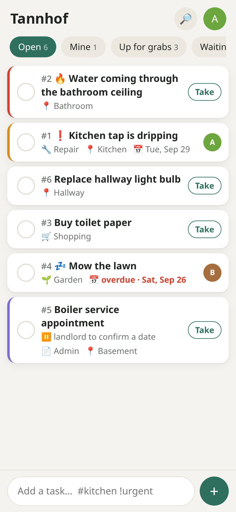
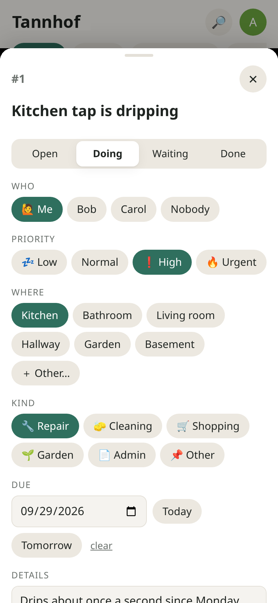
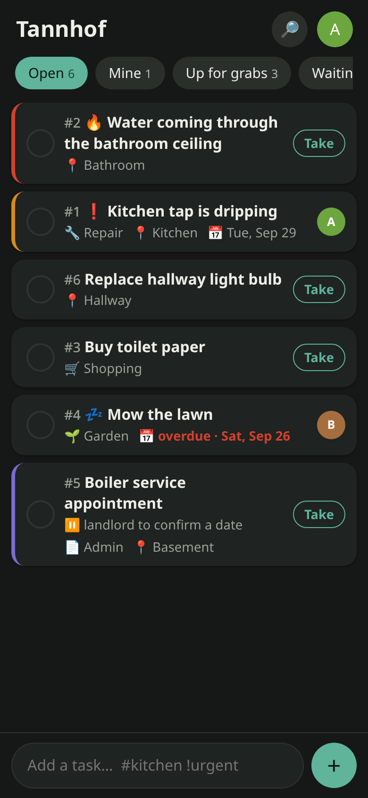

# houseops-bot

Shared tasks for a communal house, in the Matrix room you already use, and
in a small mobile web app. Both are views of the same list: a change in one
shows up in the other within seconds.

Deliberately simple: a task is a sentence, everything else is optional.

<p>
  
  
  
</p>

## Using it (for housemates)

**Create**: in the house room:

```
!task Kitchen tap is dripping
!task Water coming through the bathroom ceiling #bathroom !urgent
!task Buy toilet paper #shopping
```

`#word` sets a place (`#kitchen`, `#roof_terrace`) or a kind (`#repair`,
`#shopping`); `!urgent`, `!high`, `!low` set the priority. A photo captioned
`!task …` creates a task with that photo.

The bot answers with a **task card** and keeps it up to date. It is edited
in place, never reposted:

```
🟠 #12 Kitchen tap is dripping
❗ High · 🔧 Repair · 📍 Kitchen · 📅 Tue 29 Sep
🙋 Up for grabs · opened by Bob
✋ take it · ✅ done · 💬 details in thread · open
```

**On a card**

| | |
|---|---|
| ✋ react | take the task (remove the reaction to give it back) |
| ✅ react | done |
| reply in the thread | a comment; photos there are attached to the task |

**Commands**: in a task's thread, or anywhere with the number (`!done 12`):

| | |
|---|---|
| `!done` · `!drop` · `!reopen` | close, drop, reopen |
| `!claim` · `!unclaim` · `!assign @name` | who does it (`!assign me`, `!assign none`) |
| `!wait new valve ordered` | waiting on something outside the house |
| `!prio high` · `!loc Garden` · `!cat repair` | details |
| `!due fri` | also `tomorrow`, `in 3 days`, `3.10.`, `2026-10-03`, `none` |
| `!desc …` · `!rename …` | description, title |
| `!tasks` · `!mine` · `!tasks waiting` · `!tasks done` | lists |
| `!web` | your personal link to the web app (sent by direct message) |
| `!help` | this overview |

A command that worked gets a 👍 reaction instead of a reply, to keep the room
readable.

**Web app**: send `!web` to the bot; it messages you a personal link. Open
it on your phone (and "Add to Home Screen" for an app icon). Type a task in
the bar at the bottom and press enter. That's it! Tap the task later to add
details, photos (camera or gallery), comments, a due date. The round button
marks a task done (with undo), **Take** claims it. `!web logout` signs you out
on every device.

**Reminders** are few on purpose:

* a daily **check-in**, only when something needs attention: overdue tasks,
  urgent tasks nobody took, claimed tasks without news for a week. Each task
  is mentioned at most every three days, and only its assignee is pinged.
* a **weekly summary** thanking whoever finished things.
* urgent tasks notify the whole room once, when created.

## How Matrix and the web stay in sync

Every edit (a command, a reaction, a tap in the web app) becomes one
`Change` applied by `Task::apply` (`src/model.rs`), which also records the
history entry. `House::change` (`src/house.rs`) stores it, then re-renders the
task's card in place. Changes made on the web are announced in the task's
thread ("🌐 Alice marked done"), so people following the thread see them; web
photos are posted into the thread as well. The web app polls a version
counter every few seconds and reloads when it moves.

Identity is always the Matrix user: the web sign-in link is minted for the
person who asked, so history says the same names in both places.

## Setup

1. Create a Matrix account for the bot and get an access token + device ID
   (as for the other bots).
2. Copy `config.example.toml` to `config.toml`; set `[matrix]`, the house
   `room_id`, and `[web] public_url`.
3. Run the container (Unraid template: `my-houseops-bot.xml`), mount
   `/app/config` and `/app/store`, publish port 8093 and put it behind the
   reverse proxy with HTTPS.
4. Invite the bot to the house room. Verify it from Element if the room is
   encrypted (`!admin verify` in a direct chat with it, as admin).
5. Send `!help` in the room.

State lives in `store/state.json` (tasks, history, and web sessions as
hashes of sign-in tokens) and `store/attachments/`. Back up `store/`.

Admins can tune reminders at runtime in a direct chat with the bot:
`!admin settings`, `!admin set digest_time 08:30`, `!admin set stale_days 10`.

### Web API

`GET /api/bootstrap` (everything the app needs), `GET /api/version`,
`POST /api/tasks {text}` (quick-add syntax), `PATCH /api/tasks/:id`
(`title`, `description`, `status`+`waiting_on`, `priority`, `location`,
`category`, `assignee`, `due`: `null` clears), `POST /api/tasks/:id/comments`,
`POST /api/tasks/:id/attachments` (multipart `file`),
`DELETE /api/tasks/:id/attachments/:id`, `GET /api/attachments/:id`.
Auth is the HttpOnly session cookie; writes also need `X-HouseOps: 1`.

## Development

```
cargo test
cargo clippy --all-targets
```

The web page is a single file, `assets/index.html` (no build step), served
with a strict Content-Security-Policy.
